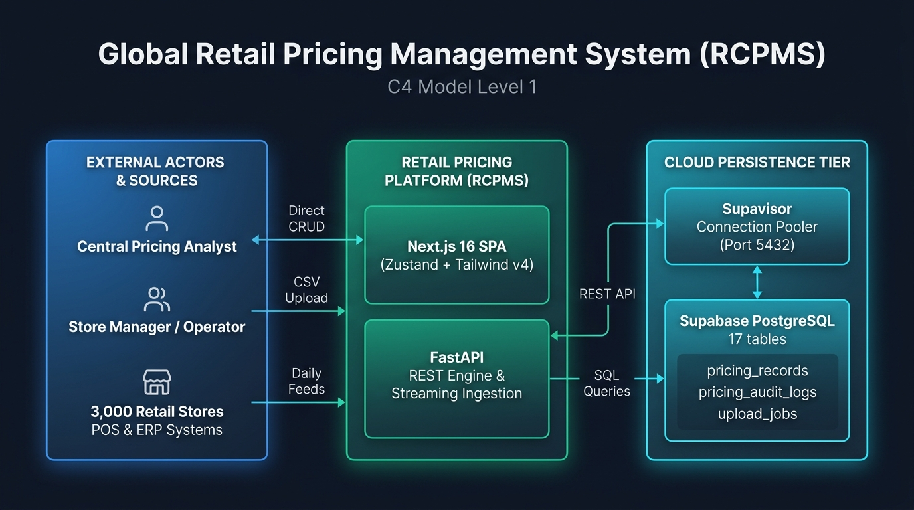
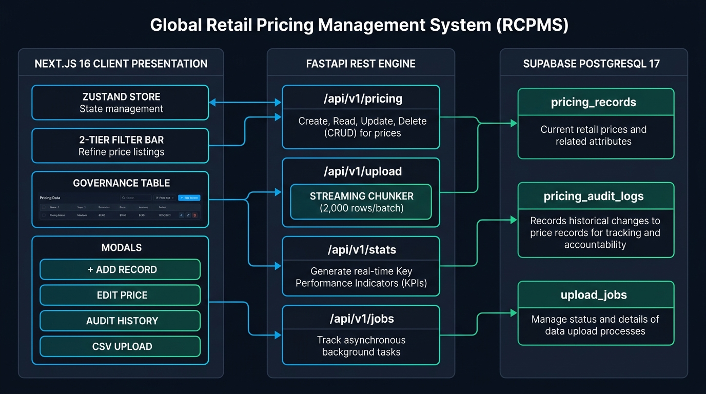
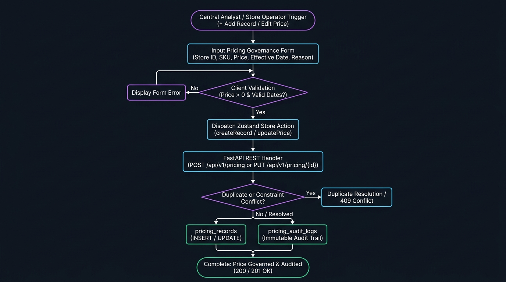
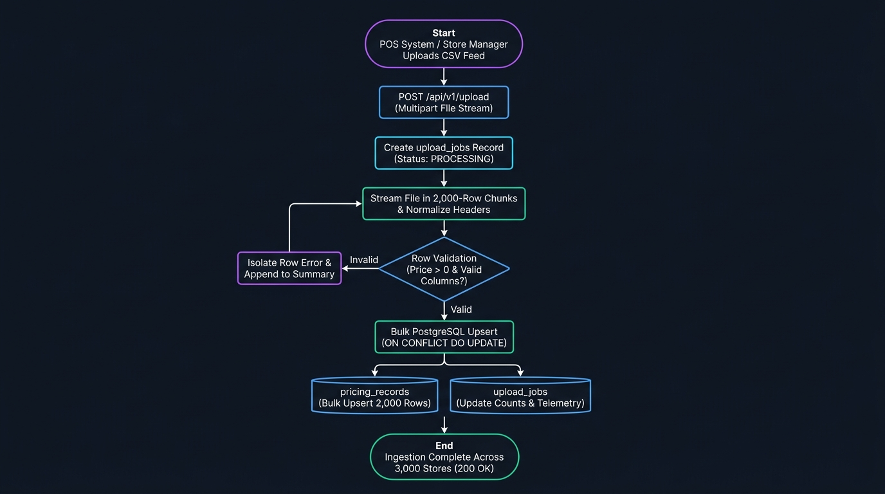
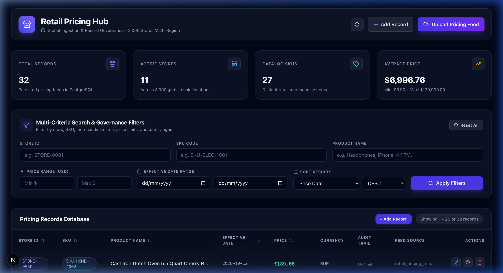
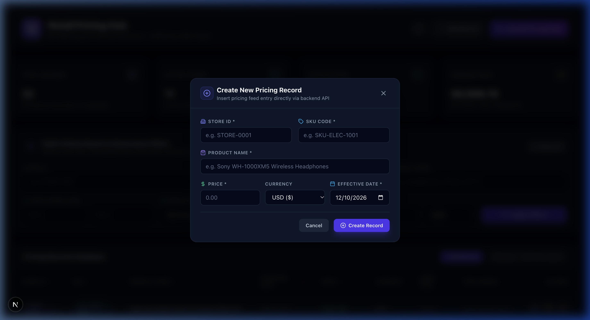
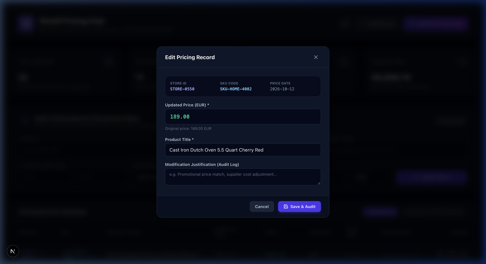
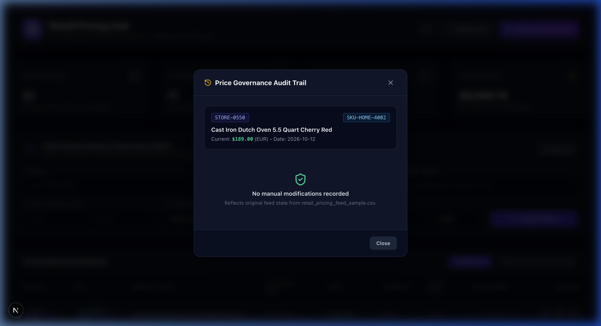
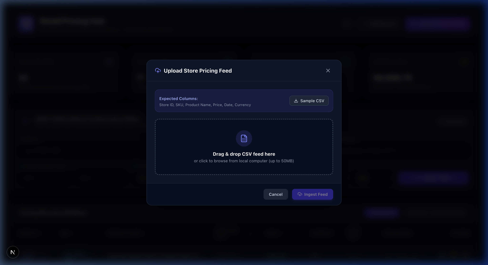

# Global Retail Pricing Management System (RCPMS)

> Enterprise-grade retail pricing ingestion, search, and price governance platform designed for 3,000 retail stores across multiple international countries. Built with **FastAPI**, **SQLAlchemy ORM**, **Supabase PostgreSQL 17**, and **Next.js** with **Zustand**.

---

## Table of Contents
1. [Context Diagram](#1-context-diagram)
2. [Solution Architecture](#2-solution-architecture)
3. [Design Decisions](#3-design-decisions)
4. [Non-Functional Requirements Addressed](#4-non-functional-requirements-addressed)
5. [Assumptions](#5-assumptions)
6. [Implementation Verification & Visual Proof](#6-implementation-verification--visual-proof)
7. [Verification Test Suite Results](#7-verification-test-suite-results)
8. [Technology Stack](#8-technology-stack)
9. [Project Directory Structure](#9-project-directory-structure)
10. [Getting Started Locally](#10-getting-started-locally)

---

## 1. Context Diagram

Visualizes how the Retail Pricing Management System sits within the enterprise ecosystem and interacts with store operators, pricing analysts, POS/ERP feed sources, and the managed database.

### System Context Flow Diagram

---

## 2. Solution Architecture

Detailed container, pipeline, and data layer breakdown showing data flow from ingestion to storage and client consumption across 3,000 retail stores.

### Solution Architecture Flow Diagram



### Operational Flowcharts

#### A. Direct Price Governance Flowchart (Create / Edit / Audit)


#### B. High-Volume Feed Ingestion Flowchart (Batch Streaming Pipeline)



---

## 3. Design Decisions

| ADR ID | Title | Context & Driver | Decision | Rationale & Trade-offs |
|---|---|---|---|---|
| **ADR-01** | **FastAPI Backend Framework** | Need high-throughput asynchronous processing for feed ingestion and quick response times for search. | Adopted **FastAPI** with **SQLAlchemy 2.0 ORM** and **Pydantic v2**. | Native async capabilities, automatic OpenAPI schema generation, strict type-checking, and seamless integration with PostgreSQL. Parameterized ORM queries eliminate SQL injection vulnerabilities. |
| **ADR-02** | **Next.js App Router + Zustand (App Shell Pattern)** | Fast, responsive single page application without boilerplate state machines. | Adopted **Next.js 16 (Turbopack)** with **Zustand** client state. **`Header`** and **`Toast`** are hoisted into **`RootLayout` (`layout.tsx`)** to form a persistent application shell that stays mounted across routes, while dashboard views (KPIs, Filters, Table, Modals) reside in `page.tsx`. | Zustand provides minimal bundle footprint, zero-boilerplate stores, selective component subscriptions (preventing full-table re-renders on filter change), and decoupled modal management. |
| **ADR-03** | **Idempotent Upsert Strategy** | 3,000 stores uploading feeds with potential retries, partial failures, or intra-day adjustments. | Implemented PostgreSQL `ON CONFLICT (store_id, sku, price_date) DO UPDATE` with `(xmax = 0) AS is_inserted` tracking. | Prevents duplicates, ensures idempotency across network retries, updates current pricing in-place without table lock contention, and distinguishes between new insertions vs updates. |
| **ADR-04** | **Streaming Chunked Ingestion** | Store feeds can contain 50,000+ SKUs per store. In-memory loading would cause OOM spikes. | Implemented streaming generator with configurable chunks (`INGESTION_BATCH_SIZE = 2,000`). | Memory usage remains bounded to ~$10MB regardless of file size; transactions commit per batch to minimize rollback scope. |
| **ADR-05** | **Application-Level Audit Trail** | Compliance and governance require knowing who changed prices, when, previous vs new values, and business reasons. | Dedicated `pricing_audit_logs` table linked via foreign key and populated on every manual edit and batch adjustment. | Guarantees non-repudiation and transparency. Storing `old_price` and `new_price` alongside modified user and justification note satisfies regulatory retail auditing. |
| **ADR-06** | **Dual Network Pooler Routing (IPv4 & IPv6)** | Modern cloud DBs (Supabase) use IPv6-only for direct instances, while corporate/ISP networks may be IPv4-only. | Configured automatic fallback with Supabase Supavisor pooler (`aws-0-ap-northeast-1.pooler.supabase.com:5432`) and configurable direct URL. | Ensures deployment portability across Docker, cloud VMs, local laptops, and Kubernetes without DNS or IPv6 routing errors. |
| **ADR-07** | **Direct CRUD API & 2-Tier Responsive Governance Layout** | Need ability to directly create individual pricing rules without mandatory batch CSV upload, avoid input control overlaps on complex filters, and maintain an audit trail for single additions. | Added `POST /api/v1/pricing` with duplicate detection and audit record creation, coupled with a 2-tier responsive grid `FilterBar` and `CreateRecordModal`. Removed clutter (health pill polling) from header. | Allows instant manual adjustments for urgent store promos, prevents UI overlapping on varied viewport sizes, and ensures 100% audit compliance for manually created records. |

---

## 4. Non-Functional Requirements Addressed

| Requirement Category | Metric / Target | Architectural Solution in RCPMS |
|---|---|---|
| **Scalability & Volume** | 3,000 stores &times; 20,000+ SKUs = 60M+ historical records | Chunked batch ingestion (2,000 records/batch); compound indexes on `(store_id, sku, price_date)` and `(store_id, price_date)`. Ready for PostgreSQL declarative range partitioning by month/year. |
| **Ingestion Performance** | Large feeds processed in seconds | High-performance bulk upserts via `sqlalchemy.dialects.postgresql.insert` with `on_conflict_do_update`; zero per-row pre-checks; database connection reuse via pool. |
| **Search Latency** | P95 < 150ms on filtered queries | Indexed database queries; subquery count optimization; server-side limit/offset pagination with customizable page sizes (10, 25, 50, 100). |
| **Idempotency & Consistency** | Re-uploading same feed produces identical state | Database-level unique constraint `uq_store_sku_date`; idempotent upsert updates modified prices and tracks update count. |
| **Auditability & Compliance** | 100% trace of manual and automated overrides | Every price change records `old_price`, `new_price`, timestamp, analyst name, and revision notes in `pricing_audit_logs`. |
| **Resilience & Fault Tolerance** | Connection drop recovery & row-level error isolation | Connection pooling with `pool_pre_ping=True` and `pool_recycle=300`. Row-level validation captures malformed rows without aborting valid rows in the batch. |
| **Internationalization** | Multi-currency & regional date variations | Dedicated `currency` field per record (USD, EUR, GBP, JPY, CAD, INR); resilient date parsing supporting ISO (`YYYY-MM-DD`), slash (`YYYY/MM/DD`), and regional formats. |

---

## 5. Assumptions

1. **Store Identity**: Each retail store possesses a unique string identifier (e.g. `STORE-0001`, `STORE-3000`, `US-101`, `UK-204`).
2. **Effective Date**: Pricing feeds represent prices effective as of a given calendar date (`price_date`). Multiple feeds for the same store, SKU, and date update the existing price for that day.
3. **Currencies**: Stores operate in their local country currency or converted standard currency. The system tracks currency per record.
4. **Feed Format**: Standard comma-separated CSV with headers (`Store ID`, `SKU`, `Product Name`, `Price`, `Date`, optional `Currency`). Header matching is case- and whitespace-insensitive.

---

## 6. Implementation Verification & Visual Proof

### 1. Operations Dashboard
Live telemetry showing active stores, catalog SKUs, clean operations header with quick action triggers, 2-tier responsive filter bar, and governance data table with clickable sort headers:


### 2. Direct Pricing Record Creation & Governance
Direct pricing rule creation modal (`POST /api/v1/pricing`) with mandatory store and SKU validation, effective date verification, and duplicate resolution:


### 3. In-Place Price Governance & Validation
In-place price editing modal (`PUT /api/v1/pricing/{id}`) with positive price constraint verification and modification justification:


### 4. Immutable Price Revision Audit Trail
Visual audit history timeline (`GET /api/v1/pricing/{id}/history`) displaying previous price, revised price, analyst identity, and timestamp:


### 5. Batch Feed Ingestion & Validation Summary
CSV drag-and-drop feed uploader (`POST /api/v1/upload`) with sample CSV download, preview, and execution breakdown:


---

## 7. Verification Test Suite Results

```text
============================= test session starts ==============================
platform darwin -- Python 3.11.14, pytest-9.1.1
rootdir: /Users/rajspc/Documents/Repos/Retail /backend

tests/test_api.py::test_health_check PASSED                              [  7%]
tests/test_api.py::test_upload_csv_flow PASSED                           [ 15%]
tests/test_api.py::test_search_and_edit_pricing PASSED                   [ 23%]
tests/test_api.py::test_validation_negative_price PASSED                 [ 30%]
tests/test_api.py::test_create_and_delete_pricing_record PASSED          [ 38%]
tests/test_api.py::test_stats_endpoint PASSED                            [ 46%]
tests/test_api.py::test_upload_jobs_history PASSED                       [ 53%]
tests/test_api.py::test_unique_stores_list PASSED                        [ 61%]
tests/test_api.py::test_upload_preview_flow PASSED                       [ 69%]
tests/test_api.py::test_duplicate_create_upsert_flow PASSED              [ 76%]
tests/test_ingestion.py::test_normalize_header PASSED                    [ 84%]
tests/test_ingestion.py::test_parse_price PASSED                         [ 92%]
tests/test_ingestion.py::test_parse_date PASSED                          [100%]

======================== 13 passed, 1 warning in 19.06s ========================
```

---

## 8. Technology Stack

- **Backend**: Python 3.11, FastAPI 0.115+, SQLAlchemy 2.0+, Pydantic v2, Uvicorn, Pytest.
- **Frontend**: Next.js 16 (Turbopack, App Router, TypeScript), Zustand 5.0, Lucide React, Tailwind CSS v4.
- **Database**: Supabase PostgreSQL 17 via Supavisor Pooler / Direct connection.

---

## 9. Project Directory Structure

```text
Retail/
├── backend/
│   ├── app/
│   │   ├── config.py         # App configuration & connection string routing
│   │   ├── database.py       # Engine, connection pool, sessionmaker, init_db
│   │   ├── models.py         # PricingRecord, PricingAuditLog, UploadJob
│   │   ├── schemas.py        # Pydantic v2 validation models & responses
│   │   ├── ingestion.py      # Streaming CSV ingestion engine & bulk upsert
│   │   ├── routes/
│   │   │   ├── pricing.py    # Direct CRUD (POST, GET, PUT, DELETE) & filters
│   │   │   ├── upload.py     # CSV file upload & preview endpoints
│   │   │   ├── stats.py      # Telemetry KPIs and aggregations
│   │   │   └── jobs.py       # Ingestion execution history
│   │   └── main.py           # FastAPI entrypoint, CORS, health check
│   ├── sample_data/
│   │   ├── retail_pricing_feed_sample.csv   # 31 global retail stores fixture
│   │   └── retail_pricing_feed_updates.csv  # Upsert test fixture
│   ├── tests/
│   │   ├── test_ingestion.py # Ingestion & parsing unit tests
│   │   └── test_api.py       # FastAPI integration tests & validation
│   └── requirements.txt
├── docs/
│   └── images/               # Architecture diagrams and UI screenshots
├── frontend/
│   ├── src/
│   │   ├── app/
│   │   │   ├── globals.css   # Minimal Tailwind CSS v4 base configuration
│   │   │   ├── layout.tsx    # Root layout, persistent shell (Header, Toast) & metadata
│   │   │   └── page.tsx      # Dashboard view (KPIs, Filters, Table, Modals)
│   │   ├── components/
│   │   │   ├── Header.tsx           # Brand identity & quick action CTAs
│   │   │   ├── KpiMetrics.tsx       # Live counters & telemetry cards
│   │   │   ├── FilterBar.tsx        # 2-Tier responsive multi-criteria search
│   │   │   ├── PricingTable.tsx     # Governance data table, sort & pagination
│   │   │   ├── CreateRecordModal.tsx# Direct pricing rule creation modal
│   │   │   ├── EditRecordModal.tsx  # In-place price editor with validation
│   │   │   ├── AuditHistoryModal.tsx# Price change timeline viewer
│   │   │   ├── UploadModal.tsx      # Drag & drop uploader with metrics
│   │   │   └── Toast.tsx            # Animated notification alerts
│   │   ├── store/
│   │   │   └── usePricingStore.ts   # Zustand global state manager
│   │   └── types/
│   │       └── pricing.ts           # TypeScript interfaces
│   └── package.json
└── README.md
```

---

## 10. Getting Started Locally

### 1. Prerequisites
- Python 3.11+
- Node.js 20+ & npm

### 2. Run Backend
```bash
cd backend
python3 -m venv .venv
source .venv/bin/activate
pip install -r requirements.txt

# Run test suite
pytest -v

# Start FastAPI development server
uvicorn app.main:app --host 0.0.0.0 --port 8000 --reload
```
API Documentation will be available at: `http://localhost:8000/docs`

### 3. Run Frontend
```bash
cd frontend
npm install
npm run dev
```
Web Application will be available at: `http://localhost:3000`
